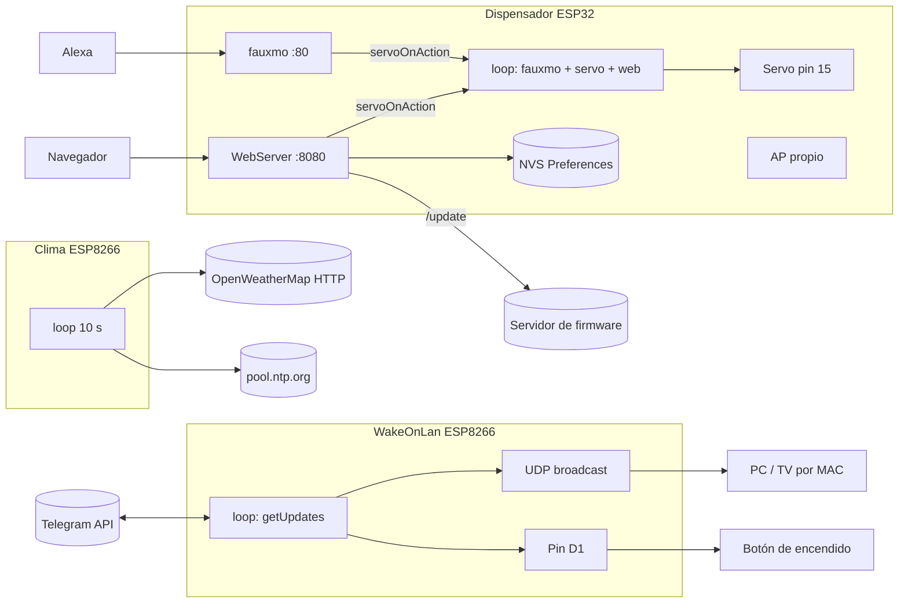

# Arquitectura — arduinoItems

El repositorio no es una aplicación sino una colección de proyectos de firmware independientes. No hay código compartido entre los proyectos propios; lo común son las librerías de terceros de `librerias/`.

## 1. Mapa del repositorio
| Carpeta | Tipo | Archivos versionados | En el grafo |
|---|---|---|---|
| `esp32-dispensador-pecera/dispensor/` | propio | 6 | sí |
| `WakeOnLan-ESP8266/` | propio | 4 | sí |
| `proyectoFinalCodigo esp8266/proyectoFinalCodigo/` | propio | 9 | sí |
| `weather/` | copia de un proyecto abierto, con claves propias | 6 | sí |
| `server/` | propio | 1 | sí |
| `proyectos/` (20 sketches) | propio y copias (Pong) | 23 | sí |
| `ESP32/`, `microbit/` | propio | 4 | sí |
| `librerias/`, `proyectos/libraries/`, `otros proyectos/` | terceros | 3.044 | no (`.cbmignore`) |
| `CoolTermWin64Bit/` | herramienta descargada | 181 | no |
| `hackwifi/`, `hack wifi ESP8266/` | material de terceros | 235 | no |
| `.codebase-memory/` | grafo versionado | 3 | n/a |

## 2. Estructura de un proyecto
Un sketch de Arduino es una carpeta cuyos `.ino` se concatenan en uno solo (orden alfabético; el que lleva el nombre de la carpeta va primero). Por eso:
- **Dispensador**: `dispensor.ino` (loop, setup, servo) + `init.ino` (memoria, WiFi, AP, Alexa) + `website.ino` (rutas y página) + `config.h` (constantes y estado global). `page.html` es una copia de la página para edición; el firmware la lleva embebida en `website.ino`.
- **WakeOnLan**: `WakeOnLan-ESP8266.ino` (configuración y dispositivos) + `SET.ino` (`setup`) + `The_important.ino` (`loop`, comandos).
- **Proyecto final**: un `.ino` principal + `Menu`, `Menu2`, `Letras`, `Numeros`, `brillo`, `geometria`, `Wifi`, cada uno con funciones llamadas desde los menús.

## 3. Diagrama de componentes (firmware con red)

## 4. Cómo se hablan
- Dentro de un sketch: variables globales y banderas (`servoOnAction`, `outputMode`, `estadoWifi`); sin hilos propios salvo la interrupción de `Timer1` en Pong.
- Con el exterior: HTTP (panel, OpenWeatherMap, OTA), HTTPS inseguro (Telegram), UDP (WOL, NTP, fauxmo/SSDP), GPIO y SPI.
- No hay base de datos ni API propia: el único estado persistente es NVS en el dispensador.

## 5. Modelo de datos
Ver `docs/ERS.md` §6. Datos en RAM: lista `devices[]` (MAC + nombre) en WakeOnLan, matrices `screen[8]` en Pong, arreglos de patrón en los sketches de LEDs.

## 6. Despliegue
Manual: compilar y cargar cada carpeta con el Arduino IDE (o PlatformIO) a la placa. No hay CI ni artefactos. El dispensador añade OTA desde las URL de `config.h`. Ver `docs/OPERACION.md`.

## 7. Dependencias externas
| Dependencia | Proyecto |
|---|---|
| ESP32Servo, WiFi, WebServer, Preferences, AsyncTCP, fauxmoESP, HTTPClient, Update | Dispensador |
| WakeOnLan, UniversalTelegramBot, ArduinoJson 5.x | WakeOnLan |
| Adafruit_GFX, Adafruit_ST7735 | Proyecto final, pruebas de pantalla, clima con pantalla |
| Adafruit_LEDBackpack | Pruebas de matriz LED |
| Arduino_JSON, NTPClient, ESP8266HTTPClient | Clima |
| TimerOne | Pong |
| Telegram Bot API, OpenWeatherMap, NTP, Alexa | Servicios externos |

Las versiones están en `librerias/` y `proyectos/libraries/` (zips y carpetas de terceros).
