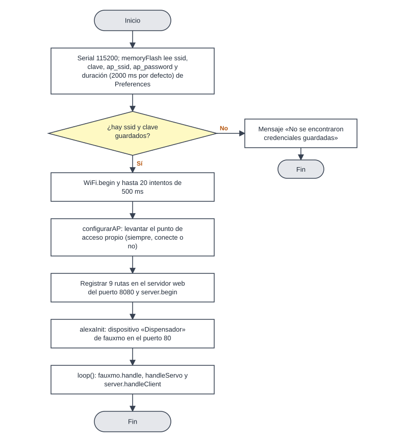
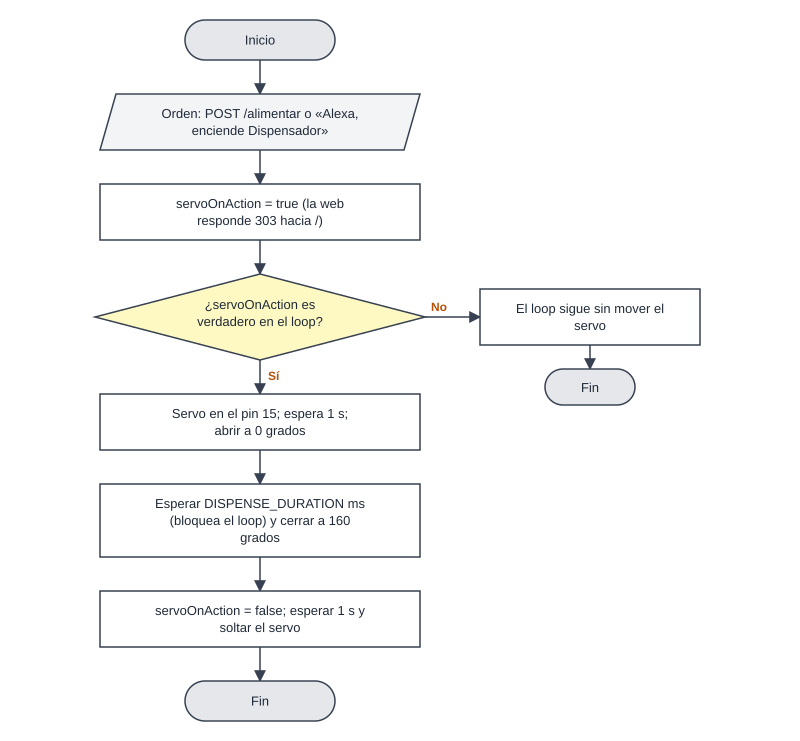
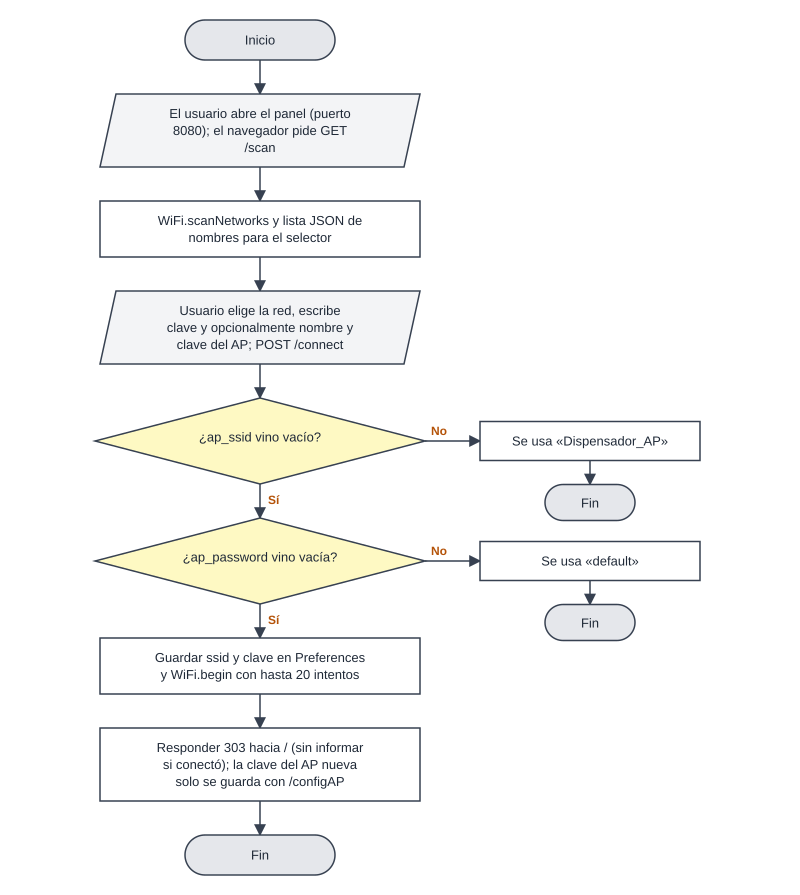
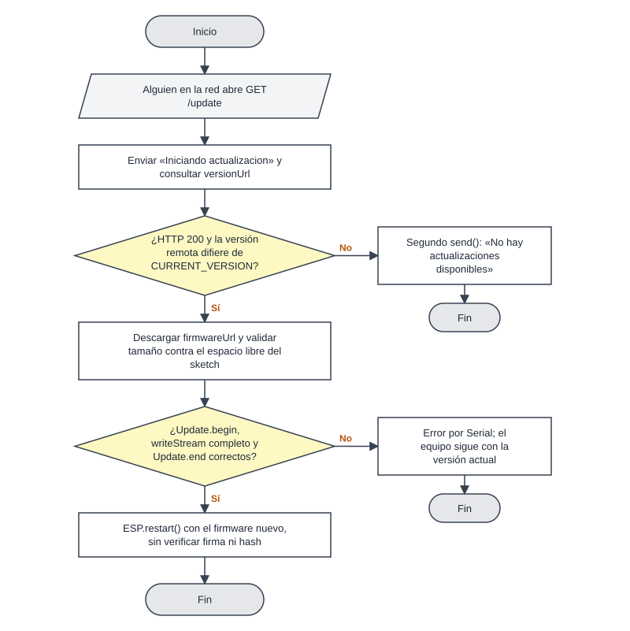
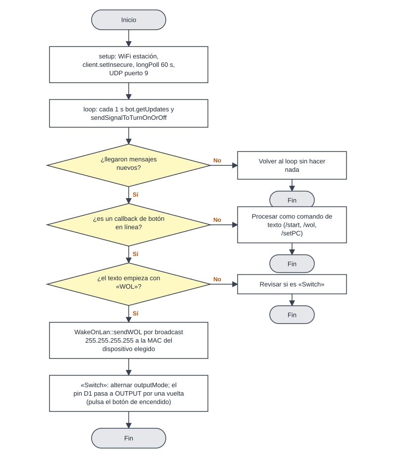
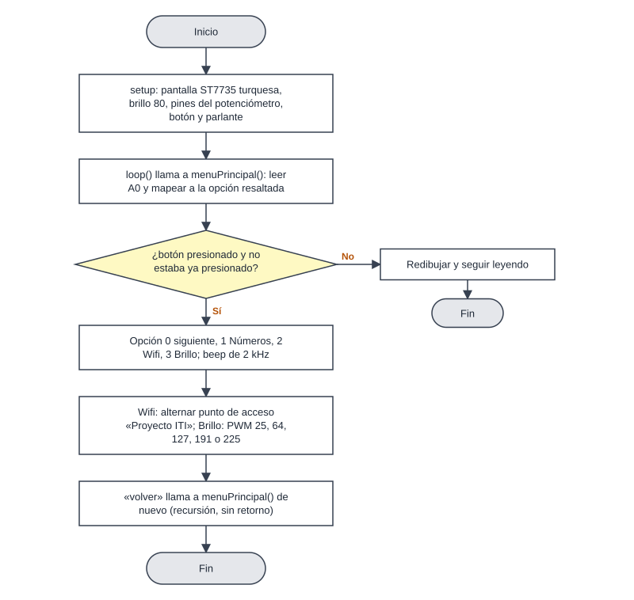
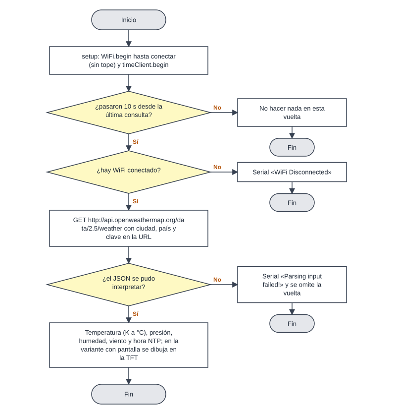
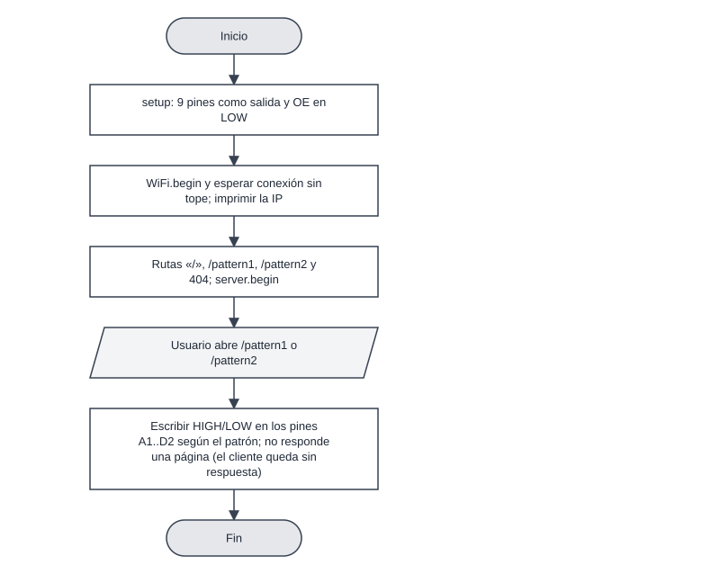
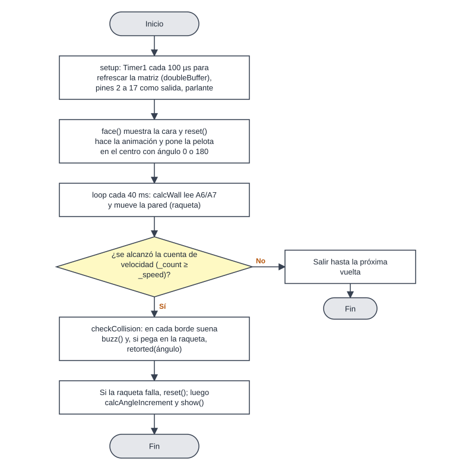

# Flujos principales — arduinoItems

Diagramas en estilo PSeInt (óvalo = Inicio/Fin, rectángulo = proceso, paralelogramo = entrada/salida, rombo = decisión con ramas «Sí»/«No»). Los rombos corresponden a `if`/guardas reales del firmware; cada paso cita `archivo:línea`. «Sí» sale hacia abajo y «No» hacia la derecha. Rutas con prefijo `DISP/` = `esp32-dispensador-pecera/dispensor/`, `WOL/` = `WakeOnLan-ESP8266/`, `PF/` = `proyectoFinalCodigo esp8266/proyectoFinalCodigo/`, `CLIMA/` = `weather/ESP8266-Weather-Station-V2-main/`.

Los flujos son los del firmware propio. Las librerías y herramientas de terceros no se describen.

Índice: 1 Dispensador, arranque · 2 Dispensador, dar de comer · 3 Dispensador, WiFi y AP · 4 Dispensador, actualización · 5 WakeOnLan por Telegram · 6 Consola de menús · 7 Clima · 8 Servidor de matriz LED · 9 Pong.

---

## 1. Dispensador: arranque

1. `setup()` abre Serial a 115200, llama `memoryFlash()`, `wifiInit()` y `alexaInit()` (`DISP/dispensor.ino:9-14`).
2. `memoryFlash` lee de NVS `ssid`, `password`, `ap_ssid`, `ap_password` (por defecto los de `config.h`) y `duration` (2000 ms) (`DISP/init.ino:1-11`).
3. `wifiInit`: si hay ssid y clave, `WiFi.begin` y hasta 20 vueltas de 500 ms; si no conecta lo anota por Serial. Si no hay credenciales, lo anota (`DISP/init.ino:14-31`).
4. Sin importar el resultado llama `configurarAP()` (`:34`), que apaga cualquier AP previo, usa el nombre por defecto si el guardado está vacío o dice «No configurado» y levanta el AP (`:50-63`).
5. Registra las 9 rutas y arranca el servidor en el puerto 8080 (`:37-47`).
6. `alexaInit` registra el dispositivo «Dispensador» en el puerto 80; si `search` es verdadero crea el servidor de fauxmo (`:82-101`).
7. `loop()` atiende fauxmo, el servo y los clientes web (`DISP/dispensor.ino:3-7`).

## 2. Dispensador: dar de comer

1. Dos orígenes ponen `servoOnAction = true`: `POST /alimentar` (`DISP/website.ino:85-89`, responde 303) y la orden «encender» de Alexa para el dispositivo 0 (`DISP/init.ino:89-99`).
2. En el siguiente `loop`, `handleServo` comprueba la bandera (`DISP/dispensor.ino:18`).
3. Adjunta el servo al pin 15, espera 1 s, abre a `SERVO_ANGLE_OPEN` (0), espera `DISPENSE_DURATION`, cierra a `SERVO_ANGLE_CLOSE` (160), baja la bandera, espera 1 s y suelta el servo (`:19-27`). Todo con `delay`, por lo que el panel y Alexa no atienden durante ese tiempo.

## 3. Dispensador: configurar WiFi y punto de acceso

1. El panel pide `GET /scan`; la placa hace `WiFi.scanNetworks()` y devuelve un arreglo JSON con los nombres, sin escapar comillas (`DISP/website.ino:17-26`).
2. El usuario elige red y clave y envía `POST /connect` (`:28-55`). Si el nombre del AP viene vacío usa «Dispensador_AP» y si la clave viene vacía usa «default» (`:33-34`).
3. Guarda `ssid` y `password` en NVS **antes** de saber si conecta (`:38-41`), intenta 20 veces y responde 303 sin indicar el resultado (`:44-54`).
4. `POST /configAP` guarda nombre y clave del AP y llama `configurarAP()` (`:57-77`); aplica las mismas sustituciones por defecto (`:61-62`). La validación de 8 caracteres mínimos solo existe en JavaScript de la página (`DISP/website.ino:482-488`).
5. `POST /toggleAP` enciende o apaga el AP (`:79-83`, `DISP/init.ino:65-80`).

## 4. Dispensador: actualización de firmware

1. Cualquier cliente que pida `GET /update` dispara el flujo (`DISP/init.ino:45`, `DISP/website.ino:166`).
2. Responde de inmediato «Iniciando actualizacion» (`:168`) y consulta `versionUrl`; si el HTTP no es 200 o la versión es igual, devuelve falso (`:147-164`).
3. Si cambia, `downloadAndUpdate` descarga `firmwareUrl`, calcula el espacio libre del sketch y exige `0 < tamaño ≤ espacio` (`:103-116`).
4. `Update.begin`, `writeStream`, `Update.end` y `isFinished`; si todo sale bien `ESP.restart()` (`:117-124`). Los errores solo se imprimen por Serial.
5. Si no hay versión nueva intenta un segundo `server.send` (`:173`) cuando ya envió la respuesta (B-18).

## 5. WakeOnLan por Telegram

1. `setup` (`WOL/SET.ino:1-36`): WiFi en modo estación, conexión sin tope, `client.setInsecure()` (`:25`), `bot.longPoll = 60` (`:32`) y `UDP.begin(9)` (`:34`).
2. `loop` (`WOL/The_important.ino:80-93`): cada 1 s pide `getUpdates`; si hay mensajes, `handleNewMessages`. En cada vuelta ejecuta también `sendSignalToTurnOnOrOff`.
3. Para cada mensaje distingue `callback_query` (botón) de texto (`:28`).
4. Texto: `/wol` arma un teclado con un botón por dispositivo (`:50-61`); `/start` lista opciones (`:64-66`); `/setPC` muestra el botón «Switch» (`:69-75`).
5. Botón `WOL<n>`: quita el prefijo, convierte a entero y envía el paquete mágico por broadcast a `devices[n]` (`:32-38`), sin comprobar el rango (B-11).
6. Botón `Switch`: alterna `outputMode` y responde «Switching PC…» (`:41-47`). `sendSignalToTurnOnOrOff` cambia el pin D1 a OUTPUT en esa vuelta, espera 75 ms y vuelve `outputMode` a falso (`:4-18`): simula una pulsación breve.
7. No se verifica el `chat_id` del remitente en ningún paso (B-09).

## 6. Consola de menús (proyecto final)

1. `setup` configura la pantalla ST7735 en horizontal, fondo turquesa, brillo 80 y los pines (`PF/proyectoFinalCodigo.ino:52-66`).
2. `loop` llama a `menuPrincipal()` (`:68-70`), que repite: leer A0, mapear a 0-3, dibujar las 4 opciones y esperar el botón (`PF/Menu.ino:3-65`; lectura en `proyectoFinalCodigo.ino:76-98`).
3. Con el botón (flanco con antirrebote por bandera, `Menu.ino:32-34,61-63`): 0 abre `menuSecundario`, 1 `numeros`, 2 alterna WiFi, 3 `brillo` (`:36-59`); cada una con un beep de 2 kHz (`proyectoFinalCodigo.ino:72-74`).
4. El submenú ofrece volver, `letrasMayus` y `animacionesGeometricas` (`PF/Menu2.ino:25-44`); «volver» invoca `menuPrincipal()` otra vez en vez de retornar (B-15).
5. Brillo escribe PWM 25, 64, 127, 191 o 225 al pin D6 (`PF/brillo.ino:25-52`).
6. Wifi alterna un AP llamado «Proyecto ITI» (`PF/Wifi.ino:1-12`).

## 7. Estación meteorológica

1. `setup`: WiFi sin tope de espera y `timeClient.begin()` (`CLIMA/esp8266_weather_forcast_v2/esp8266_weather_forcast_v2.ino:24-39`).
2. `loop`: solo actúa si pasaron 10 s (`:45`) y hay WiFi (`:46`; si no, «WiFi Disconnected» en `:88`).
3. Pide `http://api.openweathermap.org/data/2.5/weather?q=<ciudad>,<país>&APPID=<clave>` (`:47-49`).
4. Si `JSON.typeof` es `undefined` imprime el error y sale (`:52-55`); si no, extrae temperatura (restando 273), presión, humedad y viento (`:57-65`), actualiza NTP e imprime (`:56,78-84`).
5. `httpGETRequest` devuelve `{}` si el código HTTP no es positivo (`:94-114`).
6. La variante con pantalla repite el ciclo y dibuja iconos en la ST7735 (`CLIMA/esp8266_weather_forcast_with_display_v2.ino:192-350`).

## 8. Servidor web de la matriz de LEDs

1. `setup` pone los 9 pines como salida y OE en LOW (`server/server.ino:22-35`), conecta al WiFi sin tope (`:38-42`) e imprime la IP (`:44-46`).
2. Registra `/`, `/pattern1`, `/pattern2` y el 404 (`:49-52`).
3. `/` devuelve una lista de enlaces (`:64-75`).
4. `/pattern1` y `/pattern2` escriben HIGH/LOW en los pines (`:88-109`) y **no envían respuesta**: el navegador queda esperando (B-14).

## 9. Pong en matriz 8x8

1. `setup`: `Timer1` cada 100 µs ejecuta `doubleBuffer` (multiplexa filas y columnas), pines 2 a 17 como salida, parlante, `face()` y `reset()` (`proyectos/LED_Matrix_Pong_game_Arduino/LED_Matrix_Pong_game_Arduino.ino:39-51`).
2. `loop` cada 40 ms: `calcWall` mueve la raqueta según A6/A7 y `enterFrameHandler` avanza cuando se cumple la cuenta de velocidad (`:112-124`).
3. `checkCollision` hace sonar `buzz()` en los bordes y llama `retorted(ángulo)` si la raqueta golpea (`:192-216`); si la pelota sale, `reset()` (`:220,223`).
4. `retorted` intenta acelerar cada 5 puntos con `_speed - 0`, que no cambia nada (`:126-130`; B-19).
